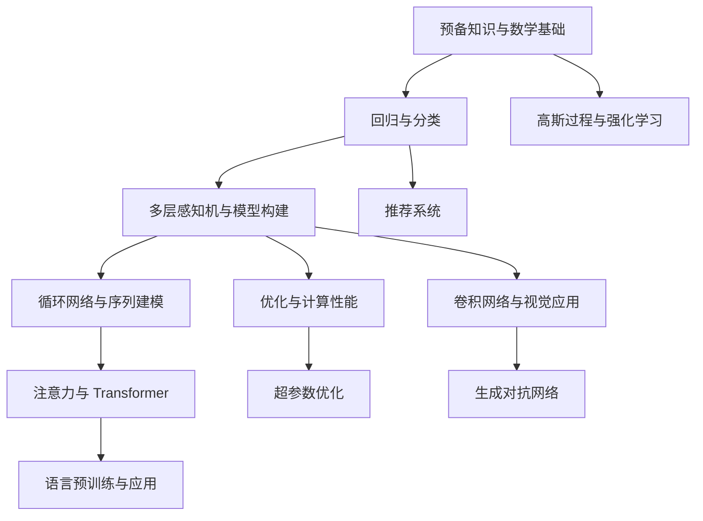

# D2L 逐章节重点内容解析

这套中文导读按当前仓库的 [教材总目录](../../index.md) 编写：23 个编号章节逐章解析，另附前言、安装、符号约定和参考文献的阅读说明，共 27 篇解析。编号章节中的 164 个目录小节按原有顺序梳理，配合原文链接、核心公式、代码阅读路线、易错点和自测问题使用。

解析基于本仓库 `ab29f50` 所包含的教材内容；英文教材上游基线为 `23d7a5aecceee57d1292c56e90cce307f183bb0a`，声明版本为 1.0.3。编写日期：2026-10-18（Asia/Shanghai）。原著作者为 Aston Zhang、Zachary C. Lipton、Mu Li 和 Alexander J. Smola；本目录是新增的学习解析，保留教材及代码的原有署名和许可。

## 使用方式

读一章时，先用解析明确它要解决的问题，再沿小节链接阅读原文，把关键公式对应到代码。最后回答自测问题；若要动手，再选择一项小实验并自行记录结果。重点学术词汇可配合 [310 条中英对照表](../GLOSSARY.zh-CN.md) 查阅。

每篇解析尽量连接以下六类内容：

1. **章定位与依赖**：为什么需要这一章，哪些概念应先掌握。
2. **逐节要点**：每节在本章解决什么问题，与前后小节如何连接。
3. **核心机制与公式**：变量、维度、假设及公式背后的直觉。
4. **代码阅读路线**：优先看哪些真实源文件，关注哪些变量和实现细节。
5. **易错点与自测**：检验自己能否解释机制，而不只是认出术语。
6. **建议实验**：可验证的学习问题和观察项；均为建议，编写导读时未执行。

正文、代码和图片不因本导读而改写。导读中的推导与说明用于帮助理解；原书报告的历史实验结果不等于当前服务器的结果。已有部署验收的实际范围见 [部署记录](../../deployment/README.zh-CN.md) 和 [validation.json](../../deployment/validation.json)，不能据此认定全书实验已通过。

## 前置阅读

| 原书入口 | 解析文档 | 需要建立的能力 |
| --- | --- | --- |
| Preface | [前言：如何建立学习闭环](00-preface.md) | 将问题、数学、代码和证据对应起来。 |
| Installation | [安装：环境、内核、框架与代码](00-installation.md) | 确认 Notebook 的实际执行环境，沿用本项目已部署环境。 |
| Notation | [符号：类型、形状与运算](00-notation.md) | 先检查对象和维度，再理解公式及其实现。 |

## 逐章目录

| 章 | 解析文档 | 本章最重要的问题 | 目录小节数 |
| --- | --- | --- | --- |
| 1 | [引言](01-introduction.md) | 什么问题可以用数据驱动的方法建模？ | 整章 |
| 2 | [预备知识](02-preliminaries.md) | 张量、求导和概率如何成为可执行计算？ | 7 |
| 3 | [线性神经网络：回归](03-linear-regression.md) | 如何把数据、模型、损失和训练组织成闭环？ | 7 |
| 4 | [线性神经网络：分类](04-linear-classification.md) | 分类输出怎样与概率、损失和评估对应？ | 7 |
| 5 | [多层感知机](05-multilayer-perceptrons.md) | 非线性、梯度传播和泛化如何共同影响学习？ | 7 |
| 6 | [模型构建指南](06-builders-guide.md) | 如何组织模块、参数、初始化、保存与设备？ | 7 |
| 7 | [卷积神经网络](07-convolutional-neural-networks.md) | 如何把图像的局部结构写入模型？ | 6 |
| 8 | [现代卷积神经网络](08-convolutional-modern.md) | 不同网络结构分别解决了什么瓶颈？ | 8 |
| 9 | [循环神经网络](09-recurrent-neural-networks.md) | 如何表示、训练和生成序列？ | 7 |
| 10 | [现代循环神经网络](10-recurrent-modern.md) | 门控、编码器—解码器和搜索解决什么问题？ | 8 |
| 11 | [注意力机制与 Transformer](11-attention-mechanisms-and-transformers.md) | 如何按内容聚合信息并建模序列关系？ | 9 |
| 12 | [优化算法](12-optimization.md) | 梯度、噪声、曲率与步长如何影响参数更新？ | 11 |
| 13 | [计算性能](13-computational-performance.md) | 如何区分计算、传输、调度和通信瓶颈？ | 7 |
| 14 | [计算机视觉](14-computer-vision.md) | 分类、检测、分割等任务如何定义输入与输出？ | 14 |
| 15 | [自然语言处理：预训练](15-natural-language-processing-pretraining.md) | 如何从语料学习词表示和上下文表示？ | 10 |
| 16 | [自然语言处理：应用](16-natural-language-processing-applications.md) | 如何把表示模型接到具体任务和评估协议？ | 7 |
| 17 | [强化学习](17-reinforcement-learning.md) | 在反馈依赖行动时如何定义和更新价值？ | 3 |
| 18 | [高斯过程](18-gaussian-processes.md) | 如何对函数建模并结合观测量化不确定性？ | 3 |
| 19 | [超参数优化](19-hyperparameter-optimization.md) | 如何在有限预算下选择训练配置？ | 5 |
| 20 | [生成对抗网络](20-generative-adversarial-networks.md) | 两个模型如何通过对抗目标共同学习？ | 2 |
| 21 | [推荐系统](21-recommender-systems.md) | 用户—物品交互如何转化为预测与排序问题？ | 10 |
| 22 | [附录：深度学习数学](22-appendix-mathematics-for-deep-learning.md) | 如何把几何、微积分、概率和统计连成基础？ | 11 |
| 23 | [附录：深度学习工具](23-appendix-tools-for-deep-learning.md) | 如何管理交互环境、计算资源和教材工程？ | 8 |

[参考文献解析：从结论追溯证据](references.md) 说明怎样沿引用键阅读论文，并区分教材简化、论文实验和自己的实现。

## 概念依赖与阅读路径

以下路径是本导读根据概念依赖给出的组织建议，学习者可以按已有基础调整。

- **建立训练基础**：前置阅读 → 第 1—6 章。应能解释一批数据如何产生预测、损失、梯度和参数更新，并能区分训练误差与泛化表现。
- **图像方向**：第 7 → 8 → 14 章。先掌握卷积的形状与结构假设，再读网络设计，最后区分分类、检测和分割的标签及指标。
- **序列与语言方向**：第 9 → 10 → 11 → 15 → 16 章。先理解序列状态和自回归，再理解注意力、预训练目标与下游适配。
- **训练效率方向**：结合第 12、13、19 章。优化器影响更新过程，系统性能影响一次试验的成本，超参数优化影响试验配置的选择；它们的目标不能混为一谈。
- **概率与决策方向**：按需查第 22 章，再读第 18 或 17 章。高斯过程强调函数分布与条件化，强化学习强调行动、奖励和长期回报；共同需要概率基础，但不是同一种建模问题。
- **生成与推荐方向**：第 20、21 章结合前面的网络和优化知识阅读。尤其要核对实际框架分支；当前推荐系统章的主要实现为 MXNet，不能假定现有 PyTorch 内核可以直接执行全部代码。

## 跨章节需要反复区分的概念

| 容易混淆的对象 | 应当如何区分 | 回看章节 |
| --- | --- | --- |
| 损失函数与评价指标 | 损失驱动优化，指标评价任务；两者可能一致，也可能不同。 | 第 3、4、14、16、21 章 |
| 优化困难与泛化困难 | 训练目标未拟合好，与训练拟合好却不能推广到新样本，是不同问题。 | 第 3、5、12 章 |
| 表达能力与训练可达性 | 能表示某类函数，不保证有限数据与某种优化过程能找到合适参数。 | 第 5、8、12 章 |
| 训练模式与推理模式 | 暂退法、批量规范化等组件在两种模式下行为不同。 | 第 5、8 章 |
| 填充掩码与因果掩码 | 前者排除无效位置，后者限制对未来信息的访问。 | 第 10、11、15 章 |
| 潜在函数不确定性与观测噪声 | 函数预测与带噪声的新观测预测具有不同的方差含义。 | 第 18 章 |
| 硬件规格与实测吞吐 | 资源规格不能替代包括同步、传输和预热条件的计时。 | 第 13、23 章 |
| 试验建议与实验结论 | 预测是待检验假设，单次观察也不自动等于普遍规律。 | 各章建议实验 |

## 固定版本中的实现阅读提示

以下是本次对原稿的静态阅读发现，相关解释已写入对应章解析；没有据此改写教材或声称完成运行复现。

| 位置 | 阅读时应注意 |
| --- | --- |
| 第 6 章自定义层 | PyTorch 的教学 `MyLinear` 使用参数的 `.data`；理解可训练层时，需要区分注册参数和让参数参与梯度计算图。 |
| 第 17 章 Q 学习 | 原文数学更新式中的目标项符号与代码不一致；解析给出正确的加性 TD 更新，并说明固定自举目标的含义。 |
| 第 18 章 GP 核函数 | 手工 `rbfkernel` 的 `ls` 参数与常见公式中的长度尺度平方对应，比较参数数值前先统一定义。 |
| 第 21 章排序评估 | 原稿候选物品集合使用了 `num_users` 的范围；物品全集应按物品数量定义，不能无条件把该示例指标当成完整物品集评估。 |

## 如何记录自己的学习实验

小实验优先改变一个因素，并固定数据切分、其余超参数和评价方法。记录下面这些信息即可使结果具有基本可追溯性：

| 记录项 | 内容 |
| --- | --- |
| 问题与假设 | 想验证什么；哪些结果会支持或反对自己的解释。 |
| 数据与切分 | 数据版本、训练/验证/测试划分、预处理拟合范围。 |
| 运行环境 | 框架版本、实际设备、关键额外依赖。 |
| 变更与对照 | 本次只改变了什么；与哪个基线比较。 |
| 随机性与预算 | 随机种子、训练轮次、批量大小、重复次数。 |
| 结果 | 原始指标、图表或日志，区分训练与验证结果。 |
| 解释与边界 | 实际观察、可能原因和还未排除的其他解释。 |

本次新增的是解析文档，不为完成文档而重复运行训练。小节覆盖、相对链接和公式语境的核对是文档检查；它们不构成算法性能或全书运行兼容性的证明。

## 在当前项目中使用

英文教材继续从 `http://127.0.0.1:8888/book/` 阅读。解析保存在 `docs/study-guide/`，可以在 GitHub 中阅读，也可以从现有 Jupyter 文件浏览器打开本目录。环境启停、登录和端口说明仍以 [部署说明](../../deployment/README.zh-CN.md) 为准。

文档核验：27 篇解析与总目录齐备，23 个编号章节的 164 个目录小节均有原文链接；本地链接、数学定界符及控制字符检查通过。对注意力、优化、GPU 计时、强化学习、GP、GAN 和推荐目标等重点内容作了源文对照复核。本次未执行新增训练实验。
